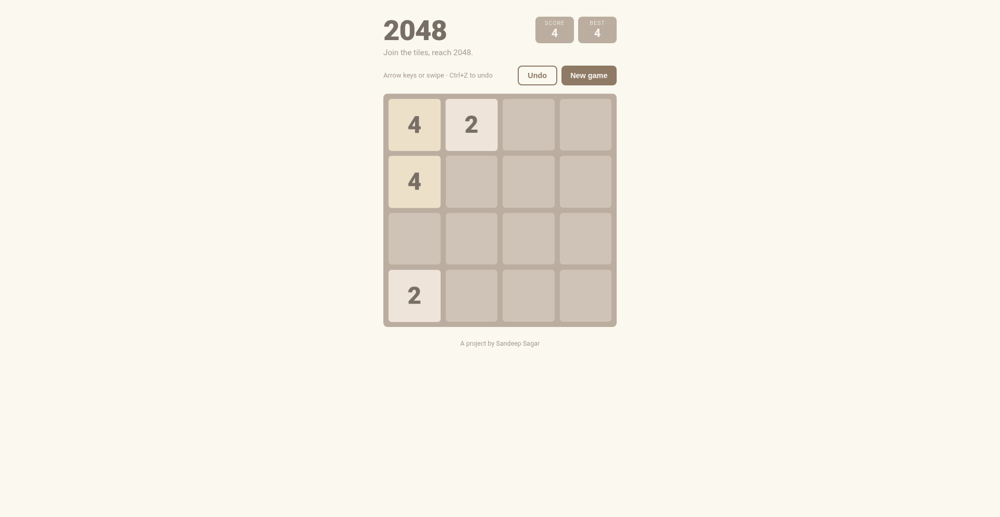

# 2048



A polished version of the classic 2048 sliding-tile game, built with React. Merge matching tiles, chase the 2048 tile, and try to beat your best score - it is saved between sessions along with the full game state.

## Features

- **Smooth tile animations** - every tile is a persistent element with its own identity, so slides, spawns and merges animate properly instead of snapping
- **Full move engine** - correct merge semantics (a tile merges at most once per move), win detection at 2048 with a "keep going" option, and game-over detection when no moves remain
- **Undo** - step back through your last 20 moves, button or `Ctrl/Cmd + Z`
- **Keyboard and touch** - arrow keys / WASD on desktop, swipe on mobile
- **Persistence** - the game and your best score survive a refresh (local storage)
- **Responsive** - the board measures itself and lays tiles out exactly at any size

## Tech

React + Vite. The entire game engine (`src/lib/game.js`) is a pure, framework-free state-transition module - board state in, new board state out - which keeps the React layer thin and the rules fully testable.

## Run locally

```bash
npm install
npm run dev
```

## Tests

```bash
npm test
```

18 Vitest cases cover sliding, single-merge-per-move semantics ([2,2,4] becomes [4,4], never [8]), edge-order merges in all four directions, spawning, no-op moves, win and game-over detection, undo, and persistence round-trips including id-collision safety after a restore.

## Build

```bash
npm run build   # static files to dist/
```

Deployed on Render as a static site: `npm install && npm test && npm run build`, publish directory `dist`.

A project by Sandeep Sagar
